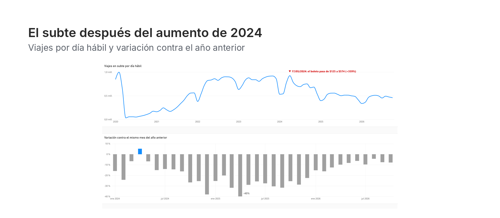
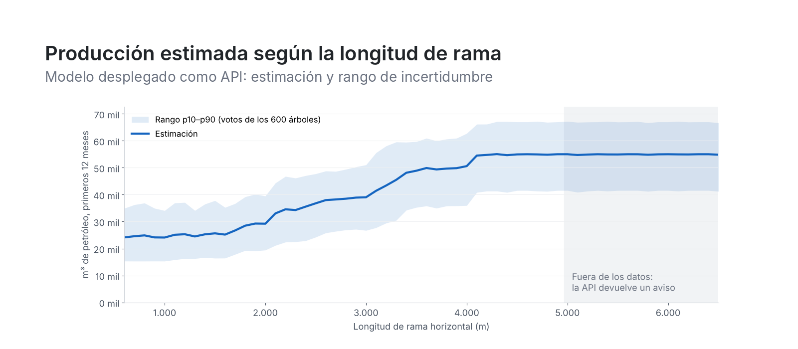
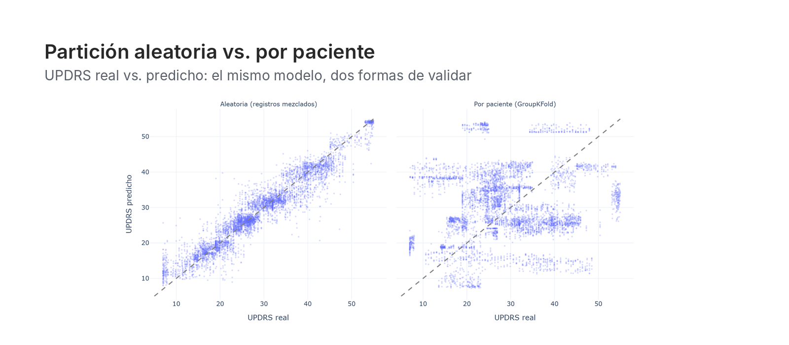
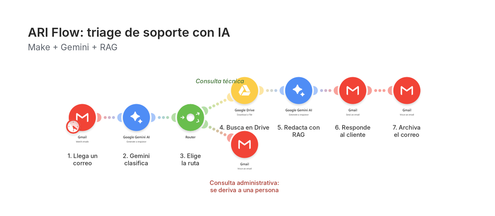

# Hola, soy Carolina Bailon Trujillo 👋

## Data Analyst / Data Scientist Junior

Estudiante avanzada de **Ciencia de Datos en Organizaciones (UNLP)** · **Buscando mi primer rol en datos** · Híbrido en La Plata o remoto

**Qué puedo aportar:**

- **SQL y modelado de datos:** consultas con CTEs y funciones de ventana, modelos en estrella en PostgreSQL.
- **Dashboards para decidir:** Power BI con DAX, con conclusiones claras y no solo gráficos.
- **Modelos predictivos bien validados:** Python, Scikit-Learn y XGBoost, evaluados como se usan en la realidad y sin métricas infladas.
- **IA aplicada a procesos:** agentes con RAG sobre la API de Gemini y automatizaciones en Make.
- **Visión de negocio:** 5 años en operaciones (caja, inventarios y proveedores) antes de dedicarme a los datos.

`SQL` `PostgreSQL` `Python` `Pandas` `Power BI` `DAX` `Scikit-Learn` `XGBoost` `Statsmodels` `PyTorch` `Plotly` `Streamlit` `Make` `RAG` `Gemini API` `Git`

## Proyectos

<table>
<tr>
<td width="50%" valign="top">

<h3><a href="https://github.com/CaroBailon/sube-amba">🚇 Movilidad en el AMBA con SUBE</a></h3>
<code>PostgreSQL</code> <code>SQL</code> <code>Power BI</code>

El subte perdió <b>el 45% de sus pasajeros</b> en dos años tras el aumento de tarifa de 2024. Modelé 3,2 millones de registros en un esquema estrella, respondí 7 preguntas de negocio en SQL y armé un dashboard en Power BI.

</td>
<td width="50%" valign="top">

<h3><a href="https://github.com/CaroBailon/vaca-muerta-predictive-analytics">🛢️ Vaca Muerta: producción de pozos</a></h3>
<code>Python</code> <code>Scikit-Learn</code> <code>FastAPI</code> <code>Docker</code>

Modelo de producción a 12 meses <b>desplegado como API</b>, con <a href="https://vaca-muerta-carolina.onrender.com/demo">demo en vivo</a>. La validación temporal muestra el rendimiento real: una partición aleatoria <b>duplica el R²</b> aparente (0,52 contra 0,26).

</td>
</tr>
</table>

<table>
<tr>
<td width="50%" valign="top">

<h3><a href="https://github.com/CaroBailon/parkinson-longitudinal-ml">🧠 Parkinson: predictores longitudinales</a></h3>
<code>Statsmodels</code> <code>XGBoost</code> <code>PyTorch</code>

Con pacientes que el modelo nunca vio, <b>el R² cae de 0,91 a −0,64</b>: la partición aleatoria hacía que "memorizara" pacientes. Validé por paciente y mostré que conocer la línea de base reduce el error un 62%.

</td>
<td width="50%" valign="top">

<h3><a href="https://github.com/CaroBailon/portfolio-agentes-ia">🤖 Agentes de IA para negocios</a></h3>
<code>RAG</code> <code>Gemini API</code> <code>Make</code>

<b>Tres agentes</b> que reemplazan tareas manuales: responden consultas de soporte con una base de conocimiento y derivan el resto a una persona, arman propuestas comerciales validando presupuesto y plazos, y generan un panel de noticias del mercado.

</td>
</tr>
</table>

**Otros:** 🍏 [Data Bite](https://github.com/CaroBailon/data-bite-ai), propuesta de producto de datos para el concurso Molinos Innova: asistente que arma planes de comida semanales personalizados.
